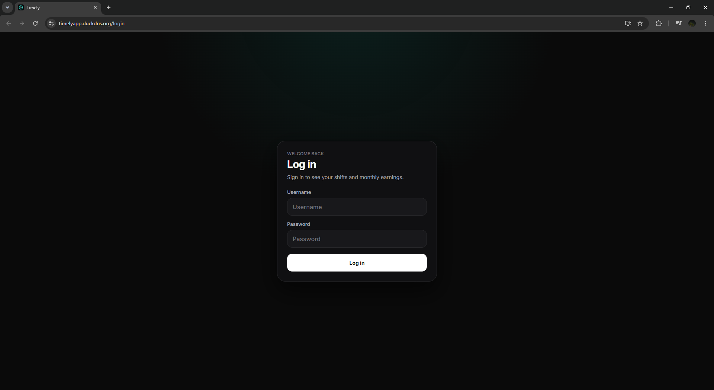
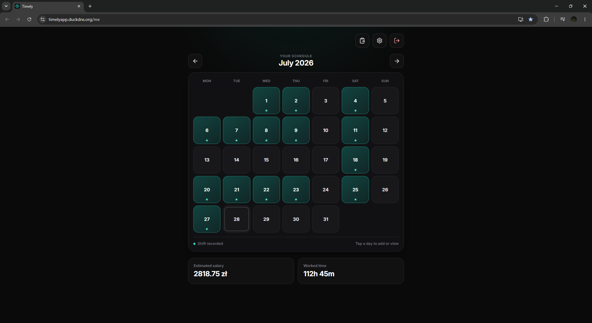
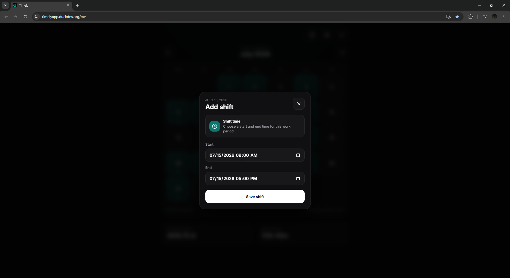
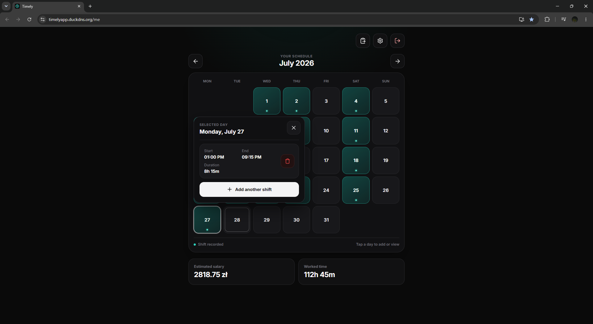
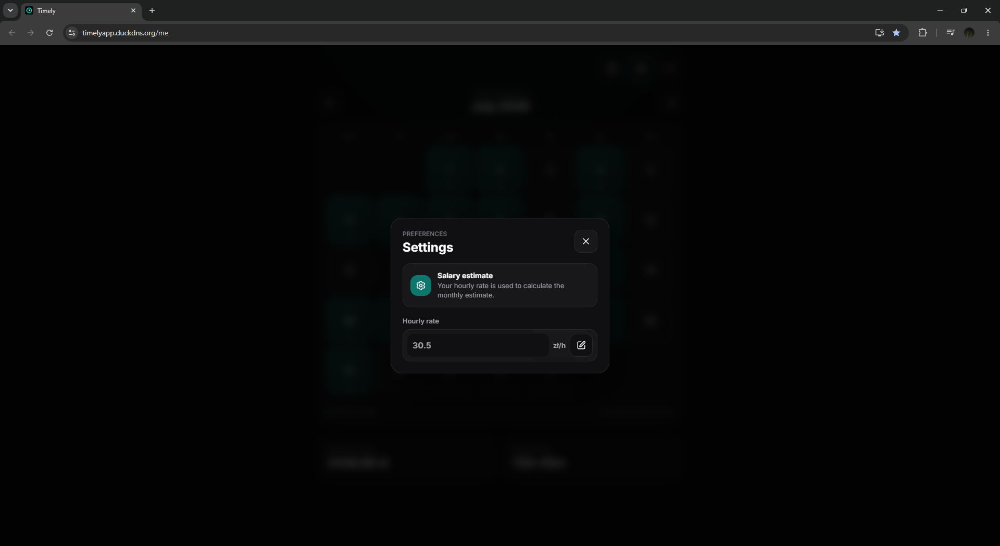
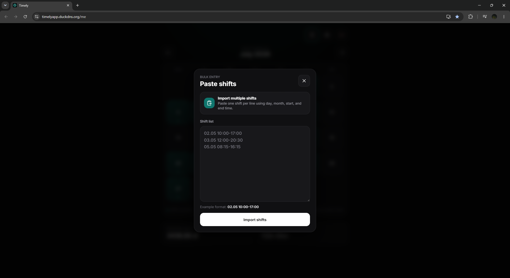

# Shift Tracker

A full-stack employee time tracking platform for logging work hours, viewing monthly summaries, and estimating salary.

## Features

- Log in with an administrator-provisioned username and password
- View shifts by month
- Add and delete shifts
- Import shifts from pasted text
- Track total worked time
- Estimate salary from hourly rate

## Local development

PostgreSQL runs in Docker; the backend and frontend run locally with their
normal development servers.

1. Copy `.env.example` to `.env` and set the PostgreSQL credentials.
2. Copy each application's `.env.example` to `.env` in its own directory and
   set the backend secrets.
3. Start PostgreSQL from the repository root:

   ```powershell
   docker compose up -d
   ```

4. Start the backend:

   ```powershell
   cd timely-backend
   .\mvnw.cmd spring-boot:run
   ```

5. In another terminal, start the frontend:

   ```powershell
   cd timely-frontend
   npm run dev
   ```

The application is available at `http://localhost:5173`. Database settings
live only in the root `.env`; backend-only and frontend-only settings remain in
their respective `.env` files. The Dockerfiles are production image builds and
are not used by this local workflow.

## VPS deployment with Docker Compose and Nginx

`docker-compose.prod.yml` runs PostgreSQL, the backend, and the frontend in
containers. The local `docker-compose.yml` remains the database-only development
setup. Both files use the `timely` Compose project with `postgres`, `backend`,
and `frontend` service names. The PostgreSQL volume retains its original Docker
name, `work-tracker_timely-postgres-data`, so an existing deployment can reuse
its data after the project is renamed.

1. On the VPS, copy the root `.env.example` to `.env` and set the existing
   database name, user, and password. For an existing database, keep the same
   credentials.
2. Copy `timely-backend/.env.example` to `timely-backend/.env`. Set
   `FRONTEND_URL=https://your-domain.example` to the exact public origin and
   set `JWT_SECRET` to a secret of at least 32 bytes. Set
   `REGISTRATION_ENABLED=false` unless you intend to allow registration. The
   production Compose file enforces secure authentication cookies.
3. In the HTTPS `server` block of the VPS's host Nginx configuration, route the
   frontend to port 3000 and `/api/` to port 8080. Preserve the `/api/` path
   when forwarding to the backend:

   ```nginx
   location /api/ {
       proxy_pass http://127.0.0.1:8080;
       proxy_set_header Host $host;
       proxy_set_header X-Forwarded-Proto $scheme;
       proxy_set_header X-Forwarded-For $proxy_add_x_forwarded_for;
   }

   location / {
       proxy_pass http://127.0.0.1:3000;
       proxy_set_header Host $host;
       proxy_set_header X-Forwarded-Proto $scheme;
   }
   ```

   The frontend is built with `VITE_API_URL=/api`, so browser requests use
   the same HTTPS origin. Nginx terminates HTTPS; the containers listen only
   on the VPS loopback interface. PostgreSQL has no host port in this setup.
   After editing the host Nginx configuration, run `sudo nginx -t` and
   `sudo systemctl reload nginx`.
4. If the old `work-tracker` stack is running on the VPS, stop its containers
   after backing up the database. This preserves its PostgreSQL volume and
   frees ports 3000 and 8080 for the renamed stack:

   ```bash
   docker compose -p work-tracker -f docker-compose.prod.yml down --remove-orphans
   ```

   On a development machine with the old database-only stack, use
   `docker compose -p work-tracker down --remove-orphans` instead.
5. Start or update the stack from the repository root:

   ```bash
   docker compose -f docker-compose.prod.yml up -d --build
   docker compose -f docker-compose.prod.yml ps
   docker compose -f docker-compose.prod.yml logs --tail=100 backend
   ```

For an existing deployment, back up PostgreSQL before updating. Flyway applies
new migrations at backend startup. If it reports a migration mismatch, inspect
the error and the database's migration history before changing the volume.
`docker compose down --volumes` deletes the application database.

## Screenshots














